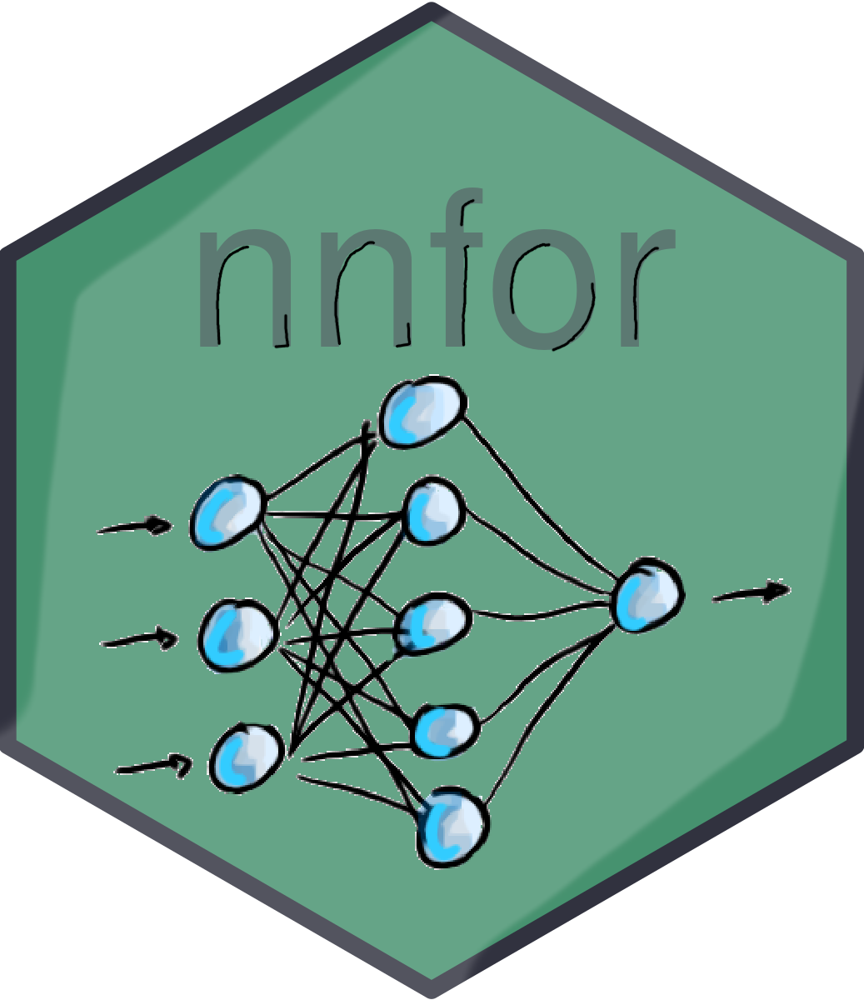

Time series modelling with neural networks for R: nnfor package
=======
[](https://CRAN.R-project.org/package=nnfor)
[](https://CRAN.R-project.org/package=nnfor)


Development repository for the nnfor package for R.
Stable version available on [CRAN](https://cran.r-project.org/package=nnfor).



## Installing

To install the development version from GitHub use:
```r
if (!requireNamespace("remotes", quietly = TRUE)) install.packages("remotes")
remotes::install_github("trnnick/tsutils")  # nnfor needs tsutils >= 0.9.5
remotes::install_github("trnnick/nnfor")
```
Otherwise, install the stable version from CRAN:
```r
install.packages("nnfor")
```

## Backends

`mlp()` trains networks with [neuralnet](https://CRAN.R-project.org/package=neuralnet) by default, which is installed with nnfor. As an option, networks can be trained with [torch](https://torch.mlverse.org), which offers modern activation functions (e.g. tanh, ReLU, GELU, SiLU) and optimizers (e.g. Adam, AdamW, RMSprop), custom architectures, and trains all networks of an ensemble simultaneously. torch is not needed for anything else in nnfor, so it does not have to be installed.

To use torch, install the package and then its libraries (a one-off download of a few hundred MB):
```r
install.packages("torch")
torch::install_torch()
```
See the [torch installation guide](https://torch.mlverse.org/docs/articles/installation.html) if this step fails. Then choose the backend when fitting:
```r
library(nnfor)
# torch with neuralnet's training setup (logistic activation, Rprop)
fit <- mlp(AirPassengers, backend = "torch")
# torch with the settings suggested in ?mlp
fit <- mlp(AirPassengers, backend = "torch", act.fct = "gelu",
           algorithm = "adam", learningrate = 0.01, stepmax = 3000)
plot(forecast(fit, h = 24))
```
Settings accept neuralnet's names (e.g. `act.fct = "logistic"`, `algorithm = "rprop+"`) as well as torch's. With torch, `hd` can also be a function returning a custom architecture. Networks are trained on the CPU, which is efficient for networks of this size.

To compare the backends on a series, with run times and in-sample and out-of-sample errors:
```r
cmp <- compare_backends(AirPassengers)
print(cmp)
plot(cmp)
```
`?mlp` describes the torch settings and the differences between the backends, and `plot(nnfor_map("mlp"))` shows where training sits among the modelling steps.

## Tutorial
You can find a tutorial on using nnfor for time series forecasting [here](https://kourentzes.com/forecasting/2019/01/16/tutorial-for-the-nnfor-r-package/).

## Author
Nikolaos Kourentzes - (http://nikolaos.kourentzes.com/)

## References
+ For an introduction to neural networks see for time series forecasting see: Ord K., Fildes R., Kourentzes N. (2017) [Principles of Business Forecasting](https://kourentzes.com/forecasting/2017/10/16/new-forecasting-book-principles-of-business-forecasting-2e/) 2e. Wessex Press Publishing Co., Chapter 10.
+ For ensemble combination operators see: Kourentzes N., Barrow B.K., Crone S.F. (2014) [Neural network ensemble operators for time series forecasting](https://kourentzes.com/forecasting/2014/04/19/neural-network-ensemble-operators-for-time-series-forecasting/). Expert Systems with Applications, 41(9), 4235-4244.
+ For variable selection see: Crone S.F., Kourentzes N. (2010) [Feature selection for time series prediction – A combined filter and wrapper approach for neural networks](https://kourentzes.com/forecasting/2010/04/19/feature-selection-for-time-series-prediction-a-combined-filter-and-wrapper-approach-for-neural-networks/). Neurocomputing, 73(10), 1923-1936.

## License

This project is licensed under the GPL3 License

_Happy forecasting!_
